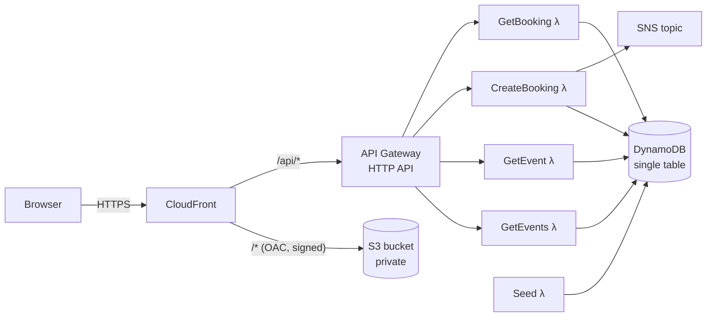
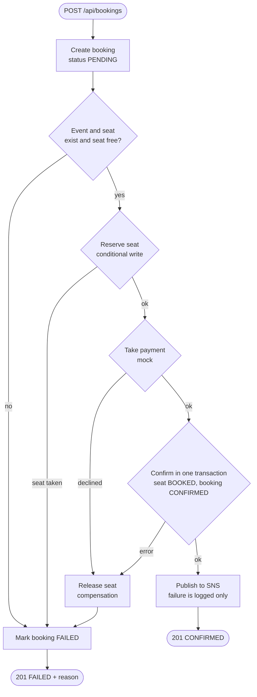

# bookinapp: event ticket booking on AWS

A small event booking system. Users list events, open an event to see which
seats are free, and book a seat. Payment is mocked and can be made to fail on
purpose, to show how a half-finished booking is undone.

- **Frontend:** plain HTML and JavaScript in a private S3 bucket, served by CloudFront.
- **API:** API Gateway HTTP API in front of Go Lambda functions (`provided.al2023`, arm64).
- **Data:** one DynamoDB table (single-table design) with point-in-time recovery.
- **Infrastructure as code:** one AWS SAM template, `template.yaml`.

## Architecture



The browser only ever talks to CloudFront. CloudFront serves the static files
from S3 and forwards everything under `/api/` to the HTTP API.

### Booking flow

`POST /api/bookings` runs these steps in order inside the CreateBooking Lambda
(`internal/booking/booking.go`). Once the seat is reserved, any later failure
releases it again before the booking is marked FAILED.



Outcomes:
- **Success:** the seat ends BOOKED and the booking CONFIRMED.
- **Declined payment:** the seat goes back to AVAILABLE and the booking is FAILED with a reason.

## How this maps to the assignment

| Requirement | Where | Notes |
|---|---|---|
| Static content from S3 through CloudFront | `WebBucket`, `WebOriginAccessControl`, `WebBucketPolicy`, `Distribution` in `template.yaml`; `web/` | Bucket blocks all public access. CloudFront reads it with Origin Access Control, and the bucket policy only allows this one distribution (`AWS:SourceArn`). |
| Application data in DynamoDB with sensible key design | `AppTable` in `template.yaml`; `internal/keys`, `internal/store` | Single table, on-demand billing, generic `PK`/`SK` plus one sparse, overloaded GSI. See [Data model](#data-model). |
| Backups | `PointInTimeRecoverySpecification` on `AppTable`; `make backup` | PITR gives continuous backups for 35 days; `make backup` takes named on-demand snapshots. See [Backups](#backups). |
| Lambda functions behind API Gateway | `BookingApi` and the `*Function` resources; `cmd/*` | One Go `main` package per Lambda, shared code under `internal/`, handlers kept thin. |
| Multi-step operation orchestrated by Step Functions | **Not included** | The booking flow is multi-step with compensation, but it runs synchronously in one Lambda. Step Functions was left out of this version by decision. See [Limitations](#limitations). |

## Data model

One table. Keys are built only in `internal/keys/keys.go`.

| Item | PK | SK | GSI1PK | GSI1SK |
|---|---|---|---|---|
| Event | `EVENT#<id>` | `META` | `EVENTS` | `<startsAt>#<id>` |
| Seat | `EVENT#<id>` | `SEAT#<nnn>` (zero-padded) | - | - |
| Booking | `USER#<userId>` | `BOOKING#<createdAt>#<bookingId>` | `BOOKING#<bookingId>` | `BOOKING` |

| Access pattern | Operation |
|---|---|
| List events by date (`GET /events`) | Query GSI1 where `GSI1PK = EVENTS` |
| Event page with all seats (`GET /events/{id}`) | Query base table where `PK = EVENT#<id>`: META and every seat in one request |
| A user's bookings, oldest first | Query base table where `PK = USER#<id>` and `SK begins_with BOOKING#` (supported by the keys, not exposed in the API) |
| Booking by id for status polling (`GET /bookings/{id}`) | Query GSI1 where `GSI1PK = BOOKING#<id>` |
| Reserve / release / book a seat | Conditional `UpdateItem` on `EVENT#<id>` / `SEAT#<nnn>` |

**Design decisions**

- **An event and its seats share a partition.** The event page is then a single
  Query that returns the event details and every seat, already in seat order.
  Seat numbers are zero-padded (`SEAT#007`), because sort keys compare as
  strings and `SEAT#10` would otherwise sort before `SEAT#2`.
- **Bookings live under the user.** `USER#<id>` groups a user's bookings, and
  putting the creation time first in the sort key returns them in time order.
  The timestamp is fixed width (`2026-10-27T18:00:05.120Z`) for the same
  string-sorting reason. The booking id on the end keeps the key unique.
- **Why a GSI to fetch a booking by id.** The base-table key of a booking needs
  the user id and the creation time, and a client polling for a status only has
  the booking id. The options were:
  1. Scan. Reads the whole table, so it is rejected.
  2. Store a second copy of each booking under `PK=BOOKING#<id>`. Gives
     strongly consistent reads, but every status change then has to update two
     items, in a transaction, or the copies drift apart.
  3. Add a GSI keyed on `BOOKING#<id>`. One item, and DynamoDB keeps the index
     up to date.

  Option 3 was chosen. Its cost is that GSI reads are eventually consistent, so
  a booking can be missing from the index for a moment after it is written. The
  frontend treats a 404 during polling as "not visible yet" and tries again. All
  writes go through the base-table key, never the GSI.
- **The GSI is sparse and overloaded.** Only items that set `GSI1PK` appear in
  it, so seats are never in the index. The same index also serves "list events
  by date" with `GSI1PK=EVENTS`, which avoids a Scan that would read every seat.
  `EVENTS` is a single partition, which is fine for a handful of events. At a
  much larger scale it would be sharded, for example by month.
- **Conditional writes prevent double booking.** Reserving runs
  `status = AVAILABLE` → `RESERVED` as one `UpdateItem` with a condition
  (`internal/store/bookings.go`). If two requests race for the same seat,
  DynamoDB applies one and rejects the other with
  `ConditionalCheckFailedException`. The earlier "is the seat free?" check
  only gives a friendlier error message; the condition is the actual guarantee.
- **Compensation only frees a seat that this booking holds.** Release runs
  only if `status = RESERVED AND bookingId = <this booking>`. A failed
  booking can never free a seat someone else bought, and running release twice
  is harmless.
- **Confirming is one transaction.** `TransactWriteItems` sets the seat to
  BOOKED and the booking to CONFIRMED together, so one can never change
  without the other.
- **Ids are validated before they go into keys.** Ids may only use
  `[A-Za-z0-9_-]`, so a request cannot inject `#` and address a different
  item.

## Backups

- **Point-in-time recovery** is enabled in the template. DynamoDB keeps
  continuous backups for 35 days and can restore to any second in that window,
  into a new table:
  ```bash
  aws dynamodb restore-table-to-point-in-time \
    --source-table-name <TableName> --target-table-name <TableName>-restored \
    --restore-date-time 2026-10-27T18:00:00Z
  ```
- **On-demand backups:** `make backup` runs `aws dynamodb create-backup`
  with a timestamped name. Use it before a demo or a risky data change. These
  backups are kept until deleted, independent of the PITR window.

An AWS Backup plan would add scheduling and retention rules. For one table,
PITR plus a one-line on-demand backup covers the need with fewer moving parts.

## API

All routes are reached through CloudFront at `https://<cloudfront>/api/...`.

| Method | Path | Response |
|---|---|---|
| GET | `/api/events` | `{"events": [{eventId, name, venue, startsAt, priceCents, seatCount}]}` |
| GET | `/api/events/{id}` | event fields + `available` + `seats: [{seatNumber, status}]` |
| POST | `/api/bookings` | body `{userId, eventId, seatNumber, forcePaymentFailure?}` → `201` with the booking (`status` CONFIRMED or FAILED, `failureReason` when failed) |
| GET | `/api/bookings/{id}` | the booking |

Invalid input returns `400`, unknown ids `404`, and unexpected errors return
`500` with a generic message (details go to CloudWatch Logs only).

**Why CloudFront forwards `/api/*` instead of using CORS:** the page and the API
share one origin, so the browser sends no preflight requests and there is no
allowed-origin list to keep in sync. There is also one URL to demo. The `/api/*`
behaviour uses the managed `CachingDisabled` policy, so API responses are never
cached, and `AllViewerExceptHostHeader`, so API Gateway receives its own host
name.

## Project layout

```
template.yaml          all infrastructure (SAM)
Makefile               sam build targets + test, seed, backup, deploy-web
cmd/<name>/main.go     one Lambda each: get-events, get-event, create-booking, get-booking, seed
internal/keys          key formats and id validation
internal/model         Event, Seat, Booking and status values
internal/store         all DynamoDB access (behind a small interface for tests)
internal/booking       the multi-step booking flow with compensation
internal/payment       mock payment provider
internal/httpx         JSON response helpers
web/                   index.html + app.js (no build step)
```

## Deploy

Prerequisites: Go 1.26+, AWS SAM CLI, AWS CLI with credentials configured, and `make`.

```bash
# 1. Build every Lambda (SAM calls the build-<Function> targets in the Makefile)
sam build

# 2. Deploy. First time: --guided asks for the region and the parameters
#    PaymentFailureRate (default 0.2) and NotificationEmail (optional).
sam deploy --guided        # later deploys: sam deploy

# 3. Load sample events (re-run any time to reset all seats to AVAILABLE)
make seed

# 4. Upload the frontend
make deploy-web

# 5. Open the CloudFrontUrl output
aws cloudformation describe-stacks --stack-name bookinapp \
  --query "Stacks[0].Outputs" --output table
```

The first deploy takes a few minutes because CloudFront has to create the
distribution. If you set `NotificationEmail`, confirm the subscription email
from SNS to receive booking notifications.

To remove everything: empty the web bucket (`aws s3 rm s3://<WebBucketName> --recursive`),
then run `sam delete`. On-demand backups are not deleted with the stack.

## Tests

```bash
make test     # or: go test ./...
```

| Test file | What it covers |
|---|---|
| `internal/keys/keys_test.go` | Key formats, numeric seat ordering, fixed-width timestamps, id validation. |
| `internal/store/store_test.go` | Conditional reservation against a fake DynamoDB that evaluates the condition atomically, as DynamoDB does. Includes 50 concurrent requests for one seat (exactly one wins), and that release only works for the holding booking. |
| `internal/payment/payment_test.go` | Failure rate 0 and 1, forced failure, and parsing of the environment variable. |
| `internal/booking/booking_test.go` | The flow end to end on an in-memory store: success, declined payment releases the seat, seat already taken, unknown event or seat, and a failed notification not undoing a confirmed booking. |

## Demo script

Set two shell variables from the stack outputs:

```bash
URL=$(aws cloudformation describe-stacks --stack-name bookinapp --query "Stacks[0].Outputs[?OutputKey=='CloudFrontUrl'].OutputValue" --output text)
TABLE=$(aws cloudformation describe-stacks --stack-name bookinapp --query "Stacks[0].Outputs[?OutputKey=='TableName'].OutputValue" --output text)
```

**0. Reset.** Run `make seed` so every seat is AVAILABLE.

**1. Successful booking**

1. Open `$URL`. The three sample events are listed (from the GSI1 query).
2. Click **Jazz Night**. The seat grid shows 24 green (available) seats.
3. Pick seat 3, leave **Simulate payment failure** unticked, and click **Book seat**.
4. The status page shows **CONFIRMED**.
5. Go back to the event. Seat 3 is now grey (BOOKED).
6. Show the stored seat:
   ```bash
   aws dynamodb get-item --table-name $TABLE \
     --key '{"PK":{"S":"EVENT#jazz-night"},"SK":{"S":"SEAT#003"}}'
   # status = BOOKED, bookingId = <the booking id>
   ```

Note that `PaymentFailureRate` declines a share of payments at random (20% by
default). For a predictable demo, deploy with `PaymentFailureRate=0` and use
the checkbox for failures.

**2. Failed payment with compensation**

1. On Jazz Night, pick seat 4, tick **Simulate payment failure**, and click
   **Book seat**.
2. The status page shows **FAILED** with the reason "payment declined: card
   declined (forced failure for demo)".
3. Go back to the event. Seat 4 is still green: it was reserved during the
   flow, then released by the compensation step.
4. Show the steps in the CreateBooking logs:
   ```bash
   sam logs -n CreateBookingFunction --stack-name bookinapp --tail
   # "seat reserved" -> "seat released" released=true -> "booking failed"
   ```

**3. Optional: two requests racing for one seat**

```bash
for i in 1 2; do
  curl -s -X POST "$URL/api/bookings" -H 'Content-Type: application/json' \
    -d "{\"userId\":\"racer$i\",\"eventId\":\"film-classic\",\"seatNumber\":1}" &
done; wait
# One response is CONFIRMED, the other FAILED ("seat ... taken" or "no longer available")
```

## Limitations

- **No Step Functions.** The flow runs inside one Lambda invocation, so there
  is no built-in retry per step, no visual execution history, and no recovery
  if the Lambda itself dies part-way. If that happens, the booking stays
  PENDING and the seat may stay RESERVED until it is fixed by hand. The same
  applies if releasing the seat fails, though the booking is still marked
  FAILED. A Step Functions Standard workflow would make each step a separately
  retried state with a Catch that routes to the release step. The steps in
  `internal/booking` already map one-to-one onto such states.
- **No authentication.** `userId` is a random id the browser generates and
  keeps in `localStorage`. Anyone who knows a booking id can read that
  booking. A real system would use Cognito and take the user id from the token.
- **No client idempotency key.** If a client resends a POST, for example after
  a network timeout, a second booking attempt is made. The conditional write
  still prevents double-booking the seat, so the repeat simply fails.
